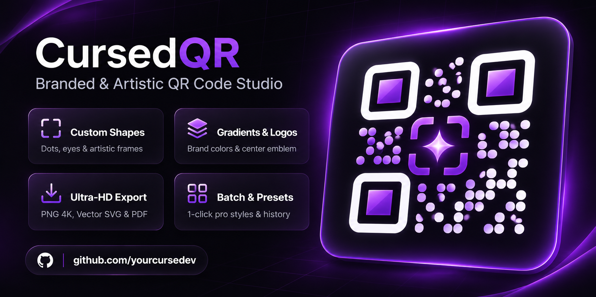

<div align="center">

<!-- Replace with your uploaded GitHub Social Preview banner -->


# CursedQR

**Branded & Artistic QR Code Studio for Windows**

[](https://dotnet.microsoft.com/)
[](https://github.com/yourcursedev/CursedQR)
[](https://github.com/yourcursedev/CursedQR/releases)
[](LICENSE)

[Download Latest Release](https://github.com/yourcursedev/CursedQR/releases) • [Features](#-features) • [Installation](#-installation) • [Build from Source](#-build-from-source) • [Report Bug](https://github.com/yourcursedev/CursedQR/issues)

</div>

---

## ✨ Overview

**CursedQR** is a flagship, offline Windows desktop studio for designing high-resolution, branded, and artistic QR codes. Built with **C# / .NET 8 WPF**, **SkiaSharp**, and **QRCoder**, it combines an obsidian-and-purple glassmorphic workspace with real-time scannability analysis, batch generation, and print-ready vector exports.

---

## 🚀 Features

### 🎨 Styling & Visual Customization
- **Custom Body Dot Shapes:** Classic Square, Rounded, Dots/Circles, Diamond, Classy/Connected, Vertical/Horizontal Bars, and Artistic Stars.
- **Independent Corner Eyes:** Customize Finder Frame and Eye Center shapes and colors separately.
- **Colors & Gradients:** Solid colors, 2-stop & 3-stop Linear/Radial Gradients with angle control, plus Transparent Background export.
- **1-Click Pro Presets:** *Cursed Royal Purple*, *Cyberpunk Neon*, *Obsidian Gold*, *Minimalist White*, *Crimson Dark*, *Emerald Glass*, *Ocean Gradient*, and *Sunset Glow*.

### 🖼️ Logos & Artistic Frames
- **Center Logo Integration:** Embed custom PNG/JPG/SVG logos or built-in crisp vector icons with automatic dot cutout/padding, shape masking (Original, Rounded Square, Circle), and size control.
- **Call-to-Action Frames:** Bottom/Top Banners, Polaroid Cards, Phone Mockup Frames, and Neon Borders with editable CTA text (e.g., `SCAN ME`, `JOIN WI-FI`, `FOLLOW US`).

### 📦 10+ Supported QR Data Types
`Website URL` • `Plain Text` • `Wi-Fi Network` • `vCard Contact` • `Email` • `SMS` • `Phone Call` • `WhatsApp` • `Geo Location` • `Crypto / Payment URI` • `Social Media Quick Links`

### ⚡ Productivity & Export
- **Live Scannability & Contrast Meter:** Instant contrast ratio validation and error-correction guidance (`L`, `M`, `Q`, `H`).
- **Ultra-HD & Vector Export:** Export to **PNG** (512px – 4096px 4K), true crisp vector **SVG**, print-ready **PDF**, or copy directly to Clipboard.
- **Batch Generator & History:** Generate styled QR folders in one click from `.txt`/`.csv` lists and manage locally saved designs.
- **Custom Setup & Uninstaller:** Ships with a themed `CursedQR-Setup.exe` wizard and clean `Uninstall.exe` integrated with Windows Apps & Features.

---

## 📥 Installation

1. Visit the [**Releases**](https://github.com/yourcursedev/CursedQR/releases) page.
2. Download **`CursedQR-Setup.exe`** (recommended) or the standalone **`CursedQR.exe`**.
3. Run the setup wizard, select your install directory and shortcuts, and launch **CursedQR**.

---

## 🛠️ Build from Source

### Prerequisites
- Windows 10 / 11 (x64)
- [.NET 8.0 SDK](https://dotnet.microsoft.com/en-us/download/dotnet/8.0)

### Build & Package
Clone the repository and run the automated PowerShell build script:

```powershell
git clone https://github.com/yourcursedev/CursedQR.git
cd CursedQR
powershell -ExecutionPolicy Bypass -File .\build.ps1
```

All compiled release artifacts (`CursedQR.exe`, `CursedQR-Setup.exe`, and `Uninstall.exe`) will be generated in the `dist/` directory.

---

## 🧱 Tech Stack

| Component | Technology |
| :--- | :--- |
| **Framework** | C# / .NET 8 WPF |
| **Rendering Engine** | SkiaSharp (High-DPI Raster, SVG & PDF) |
| **QR Matrix** | QRCoder |
| **Packaging** | Custom WPF Installer & Uninstaller (`build.ps1`) |

---

## 📄 License

Distributed under the **MIT License**. See [`LICENSE`](LICENSE) for more information.

---

<div align="center">
Built by <a href="https://github.com/yourcursedev"><strong>yourcursedev</strong></a>
</div>
